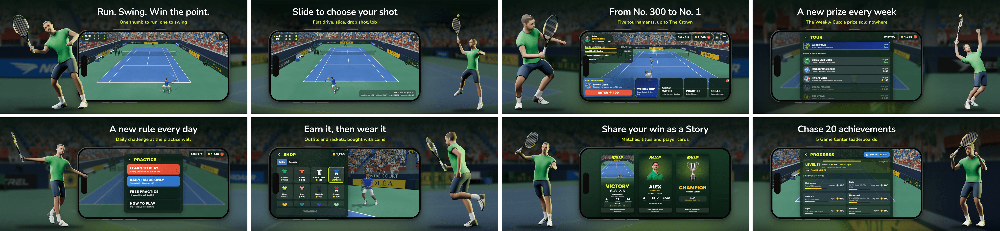
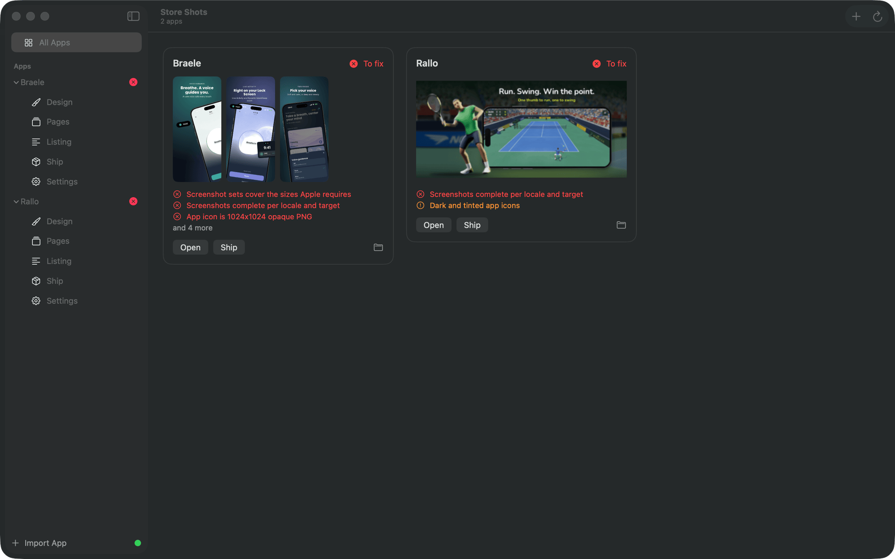
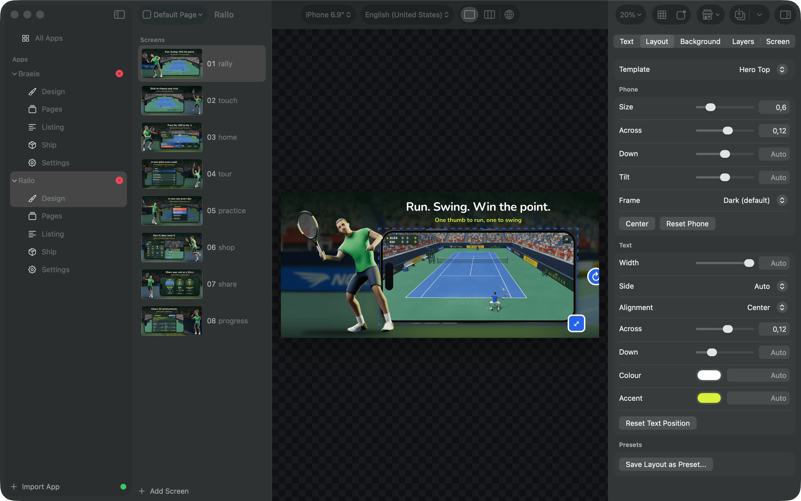
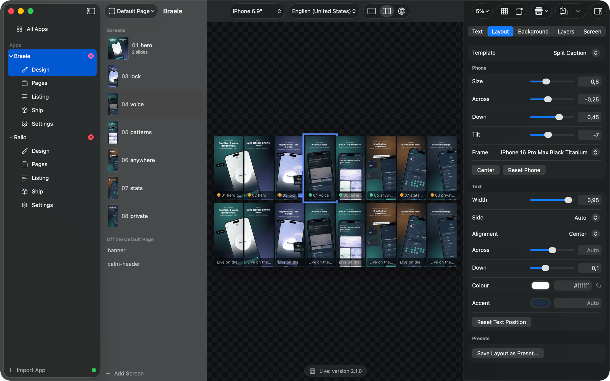
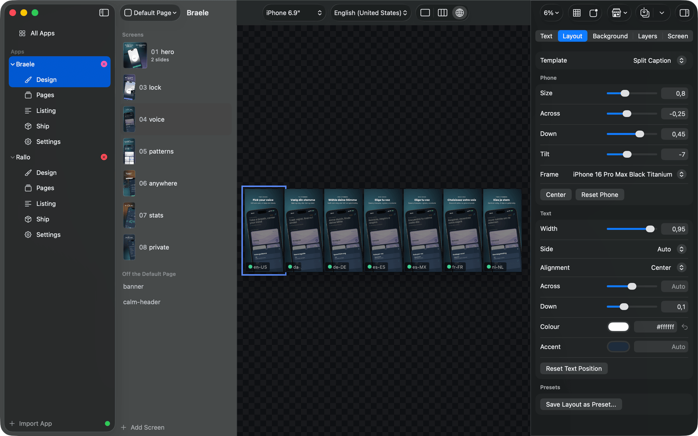
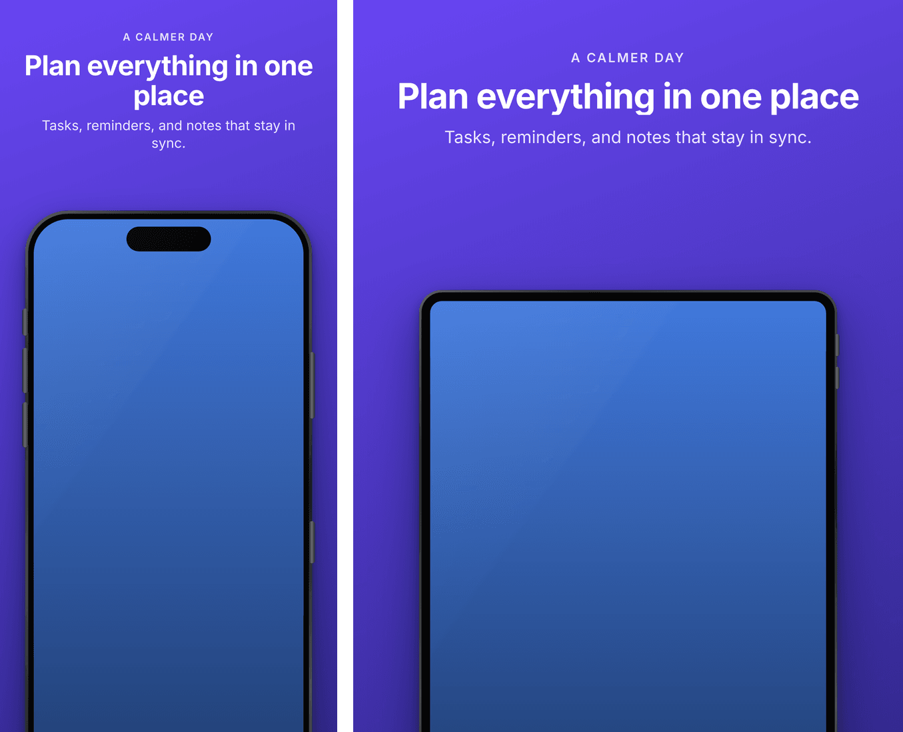
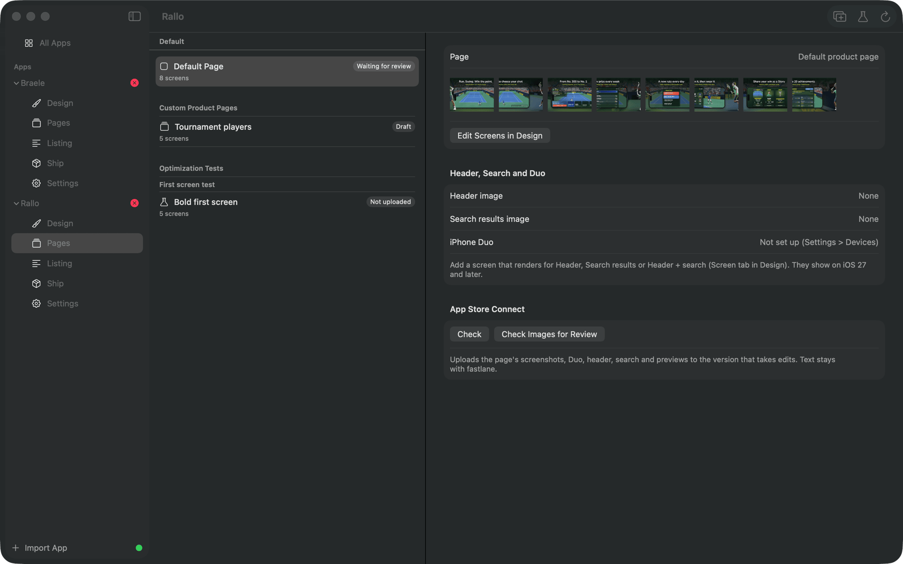
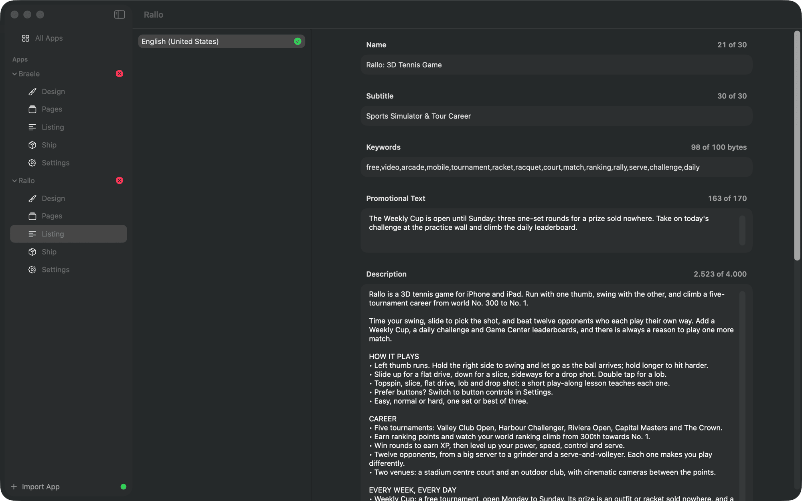
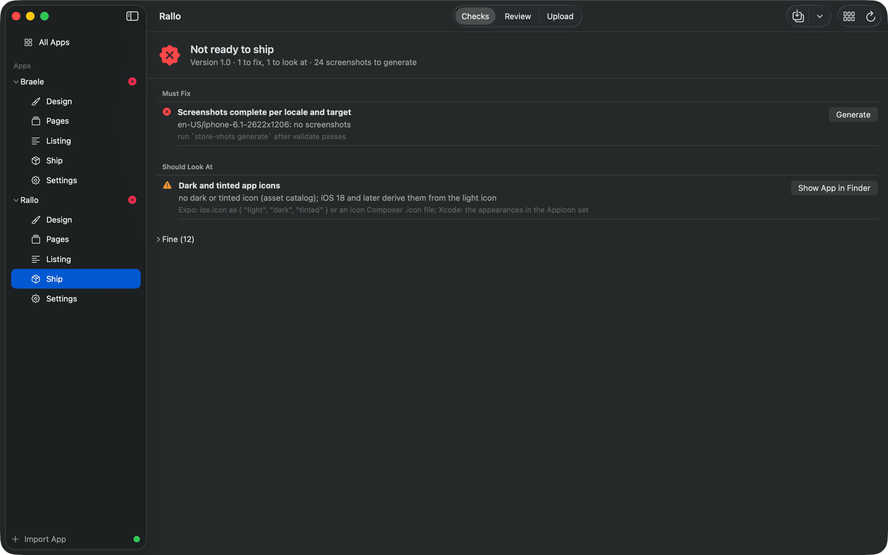

# store-shots

**App Store and Google Play screenshots, built from your app's real captures and checked against
the rules that get listings rejected.** A native Mac app over an open-source engine that runs on
your machine: no account, nothing uploaded unless you ask for it.



That listing is one project in this tool: the game's own captures in a real iPhone body, a 3D
player rendered from the game's models in front of each phone, and a stadium backdrop that runs
on from one screen to the next.

Making an image look good is the easy half. The other half is knowing, before you upload, that
the German headline no longer fits at the smallest allowed size, that Arabic needs a fallback
font for three glyphs, that the keywords are 104 bytes in Japanese, and that a caption still
says "50% off". The tool checks all of that while you edit, and again before anything ships.

- **Design** every screen on a canvas that is the exact render the store gets.
- **Pages**: the default product page, custom product pages, optimization tests, the iOS 27
  header and search results images, and iPhone Duo sets.
- **Listing**: name, subtitle, keywords and the rest of the store text, per language, with the
  store's limits.
- **Ship**: readiness checks with the fix for each, a review of every file, fastlane uploads, and
  drafts in App Store Connect.

## Get started

You need macOS 14 or later, Xcode, Node 22 and XcodeGen.

```sh
git clone https://github.com/enso-works/appstore-management-tool.git store-shots
cd store-shots && npm ci
brew install xcodegen
sh mac/build.sh --open        # builds mac/build/Store Shots.app and opens it
```

The app starts the engine from this folder (or uses one already running) and stops it on quit.
Then **Import App** (Command-O) and pick the app's folder. It reads what the app already says
about itself and proposes a setup you can change before anything is written:

- name and bundle id from Expo's `app.json`, a Capacitor config, or the Xcode project
- languages from `fastlane/metadata`, or the app's own
- landscape sets for an app that only runs sideways, iPad sets only if it runs on iPad
- Google Play sets when `fastlane/metadata/android` exists

Importing writes `store-shots.config.json` and a `store/` folder into the app, never overwrites
anything, and adds the app to the sidebar. Not on a Mac? Everything below the window works from
the [command line](#command-line), and `npx store-shots open` runs the same editor in a browser.



## Design

Each screen is a template filled with copy per language, a raw capture, and whatever you put on
it. The sidebar of the section lists the page's screens in order; the inspector edits the one
you picked, in tabs: **Text**, **Layout**, **Background**, **Layers** and **Screen**.



- Click the phone or the text on the canvas to pick it, drag to move, Option-drag to tilt,
  Shift-drag to scale, arrow keys to nudge. Clicking text marks its field in the inspector.
- Copy is edited in the inspector, with the room left in each field for this template and
  device.
- Drop a PNG or JPEG from Finder on a screen, or on the canvas, to make it that screen's capture
  for the device and language shown. A broken image never replaces a good one, and the replaced
  file is kept in `store/generated/replaced-captures/`.
- The status at the foot of the canvas runs the checks a build runs, as you type: text that
  overflows at the minimum font size, text over the device, missing glyphs, missing copy.
- Edits save themselves a moment after you stop, and Command-Z undoes them.

The toolbar picks the page, device and language, and the view:

- **One**: one screen at a time.
- **Strip**: every screen side by side, the way the store shows them. **Live Listing** puts
  what the App Store shows today, for a storefront you pick, under your drafts.
- **Languages**: one screen in every language at once.





**App Store look** shows the screens as the store does (dark page, rounded corners), and
**Guides** draws the safe padding, centres and thirds and, for header images, the two crops
App Store Connect makes.
**Generate** renders every file, or only the screen shown, and the menu next to it opens the
last run: what changed, what was skipped, and the log.

Command-K jumps to any app, section, screen, page, language or device, or runs an action.

**Themes** make the first look for you. Import App starts an app in one of six (Aurora, Bold,
Paper, Swing, Split, Card), drawn in the app's own colour, read from `app.json`, the asset
catalog or the icon; **Screen > Theme...** restyles an app you already have, previewed in its
own captures, and Command-Z undoes it. Copy, captures and layers are never touched.

### A phone that looks like one

The capture sits in a drawn iPhone body: titanium band, glass border, Dynamic Island, buttons in
the right place in portrait and landscape. iPads get their own band and buttons. The body is
drawn around the display, so the capture keeps its full size. Official device frames from
`fastlane frameit` work too (`frames setup`, then **Frame** in the Layout tab).



### Art on top

Any screen can carry image and text layers above the template: a badge, a logo, or a character
standing in front of the phone. Pick art from `store/assets` by thumbnail, drag it like the
phone, and limit it to some devices: a wide iPhone canvas and a squarer iPad canvas want
different positions. The Layers tab shows which devices each layer draws on, and **Own copy
here** splits a shared layer so this device's copy moves on its own.

Rallo's players are rendered in Blender from the game's own rigged model and animations, and the
scripts that make them live in the app (`store/scenes/`). `scenes` in the config lists them as
steps, and `store-shots scenes render` runs the ones whose scripts or inputs changed, Blender
headless, then any post-processing. `--quick` renders a quarter-size draft.

```json
"scenes": {
  "steps": [
    { "id": "characters", "blender": "store/scenes/characters.py", "args": ["{work}/chars"],
      "inputs": ["public/models/nole.glb"] },
    { "id": "post", "python": "store/scenes/post.py", "needs": ["characters"],
      "outputs": ["store/assets/characters/serve.png"] }
  ]
}
```

## Pages

A product page is a set of screens in an order. Pages lists the default page, custom product
pages (up to 70) and optimization treatments (up to 3 per test), each with its state in App
Store Connect. Make a new one from the page menu in Design or here.



- A page shows its own screens in its own order: move them, take them off, add any screen,
  including ones the default page leaves out.
- Copy you edit while a page is shown belongs to that page; everything else comes from the
  default page.
- A custom page has a deep link, and per language its promotional text (170 characters) and the
  keywords it answers to, picked from the app's own keyword field. A treatment can test an
  alternate app icon.
- Generate renders a page into `store/generated/sets/<id>/<locale>/`, numbered from 01.

### Header and search results images

Since iOS 27 a product page can lead with a wide header image, and search results can show a
creative image instead of the first screenshots. Three devices render them from the iPhone
captures with the `feature-graphic` layout:

- `header-3840x1646`: the product page header (21:9);
- `search-3840x2560`: the search results image (3:2);
- `universal-5244x2950`: one 16:9 image for both. App Store Connect crops it to 21:9 for the
  header and 3:2 for search, so the layout keeps text and device where both crops show them,
  and **Guides** draws the two crops.

A page shows one of each. A screen made only for them takes no screenshot position: give it
`"enabled": false` and add it to the pages that show it.

### iPhone Duo

The foldable iPhone has its own screenshot sets, which App Store Connect requires from April
2027: `iphone-duo-1398x2034` (outer screen) and `iphone-duo-2007x2853` (inner screen), and the
same in landscape. They render from the iPhone captures, or from Duo captures with
`sourceDevices`, into `store/generated/duo/<locale>/`, because fastlane has no display type for
them yet.

### In-app events

Event media render from the same captures: `event-card-1920x1080` and `event-detail-1080x1920`,
into `store/generated/events/`. Like the Play feature graphic, they are opt-in per screen.

### App Store Connect

The tool talks to App Store Connect with the app's own API key, found the way fastlane and
Apple's tools find it: `APP_STORE_CONNECT_API_KEY_PATH`, `fastlane/asc_api_key.json`, or
`AuthKey_<KEY_ID>.p8` in `fastlane/` or `~/.appstoreconnect/private_keys`. The key is read in
memory only to sign a token, and never written or logged.

Each page in Pages has **Check** and **Upload Draft**: every upload shows its plan first and
changes nothing until you confirm (on the command line, `--yes`).

- **Custom pages and treatments**: creates or updates the page, its version, text, keywords and
  screenshots as a draft, and keeps App Store Connect's id in the manifest. It refuses stale
  renders and leaves a page in review alone.
- **The default page**: on a version that takes edits (Prepare for Submission, or rejected) it
  uploads the screenshots, iPhone Duo sets, header and search images, and app previews. The
  version's text stays fastlane's job, and so does making the version.
- **Header and search images** go to the app's Asset Library, named by checksum so an unchanged
  image is not sent again. With no version taking edits, they wait there as drafts; **Submit
  Images for Review** on the default page sends those images (and only those) to Apple, and
  once they are approved the next upload places them on the live page, no new version needed.

The tool never submits a version, a custom page or an experiment, and never runs a lane that
builds or submits: those stay a click in App Store Connect.

## Listing

Name, subtitle, keywords, promotional text, description, what's new, and the support,
marketing and privacy URLs, per language, read from and written to
`fastlane/metadata/<locale>/*.txt`. Each field counts against Apple's limit (keywords in bytes,
as Apple counts them), a language with no text yet starts from the default one, and what's new
can be copied to every language.



## Ship

Ship is the last look before anything leaves your Mac.



- **Checks** follow Apple's own guidance, each with how to fix it:
  - **Sizes**: the 6.1" iPhone set Apple names as required, and iPad 13" for iPad apps
  - **Keywords**: 100 bytes (not characters), no plurals of words already there, no category
    names, no "app", no repeated words, nothing under three characters
  - **Screenshot copy**: no prices, discounts, URLs, ©, other platforms or stores, or Apple
    awards
  - **Files**: PNG or JPEG, exact sizes, no alpha, the same count in every language
  - **Dark Mode**: a screen marked as dark when the app follows the system appearance
  - **Icons**: dark and tinted variants (Expo `ios.icon`, an Icon Composer file, or the asset
    catalog)
  - **App previews** in `store/previews/<locale>/`: 886x1920 or 1200x1600 either way round,
    15-30 seconds, at most 30 fps and 500 MB, three per device
- **Review**: every generated file per language; click one for Quick Look. **Contact Sheets**
  writes one image per language and device.
- **Upload**: the app's own fastlane lanes for metadata and screenshots, each showing what it
  will change first. App Store Connect drafts upload from [Pages](#app-store-connect). A system
  notification says when a long run finishes while you are elsewhere.

## Settings

Per app: the devices to render for, grouped as Apple names them; languages and the default
one; brand colours; fonts, downloaded once from Google Fonts into `store/assets/fonts`; and
whether the App Store Connect key is found.

## Screenshot sizes

Every device renders at the exact pixel size the store accepts, as an opaque PNG.

| Device                                                              | Store                                                  | Size        |
| ------------------------------------------------------------------- | ------------------------------------------------------ | ----------- |
| `iphone-6.9-1320x2868`                                              | App Store, iPhone 6.9"                                 | 1320 × 2868 |
| `iphone-6.1-1206x2622`                                              | App Store, iPhone 6.1" (the size Apple names required) | 1206 × 2622 |
| `ipad-13-2064x2752`                                                 | App Store, iPad 13" (required for iPad apps)           | 2064 × 2752 |
| `iphone-6.9-2868x1320`, `iphone-6.1-2622x1206`, `ipad-13-2752x2064` | The same, landscape                                    |             |
| `iphone-duo-1398x2034`, `iphone-duo-2007x2853` (and landscape)      | App Store, iPhone Duo outer and inner screen           |             |
| `header-3840x1646`                                                  | App Store product page header (iOS 27)                 | 3840 × 1646 |
| `search-3840x2560`                                                  | App Store search results image (iOS 27)                | 3840 × 2560 |
| `universal-5244x2950`                                               | Header and search results in one image (iOS 27)        | 5244 × 2950 |
| `event-card-1920x1080`, `event-detail-1080x1920`                    | In-app event card and details page                     |             |
| `appreview-6.9-886x1920`                                            | App Preview poster                                     | 886 × 1920  |
| `play-phone-1080x1920`                                              | Google Play, phone                                     | 1080 × 1920 |
| `play-feature-1024x500`                                             | Google Play, feature graphic                           | 1024 × 500  |

Generate renders every device × language × screen, checks the size of each file before writing
it, and skips anything whose inputs have not changed.

## Command line

Everything the app does runs from a terminal too, for CI or for working without the window.
`--project` takes an app folder or its config; without it, the CLI looks upward from the
current folder, so inside an app you can leave it off.

```sh
npx store-shots open      [name|dir]          # the editor in a browser
npx store-shots init      [--project <app>] [--landscape|--portrait] [--theme <id>] [--accent <hex>]
npx store-shots theme     list | apply <id> [--accent <hex>] [--dry-run]
npx store-shots add       [dir]               # add an app that already has a config
npx store-shots projects | remove <name> | prune
npx store-shots validate  [--project <app>] [--dry-run] [--json]
npx store-shots readiness [--project <app>] [--json]
npx store-shots generate  [--project <app>] [--locale de-DE] [--screen home] [--target <id>]
                          [--set <id>] [--strict] [--force] [--dry-run] [--json]
npx store-shots check     [--project <app>]   # CI gate: validate + readiness + metadata limits
npx store-shots capture   --screen home --device iphone [--locale de-DE] [--clean-status-bar]
npx store-shots fonts     add "Space Grotesk" | list | check
npx store-shots metadata  validate | show --locale de-DE
npx store-shots lane      validate | metadata | screenshots [--yes] [--override "<reason>"]
npx store-shots sheet                         # contact sheets
npx store-shots frames    setup | list        # official device frames
npx store-shots scenes    list | render [step...] [--force] [--quick]
npx store-shots asc       status | push <page> [--yes] | submit default [--yes]
npx store-shots clean     [--project <app>]   # removes only files the tool wrote
```

Exit codes: `0` ok, `1` validation or readiness failed, `2` usage or config error.

## Files in your app

```text
store-shots.config.json                        devices, languages, brand, fonts
store/manifest.json                            screens, order, template, layers, pages
store/content/<locale>.json                    copy per language
store/raw/<device>/<locale>/<order>-<id>.png   captures
store/assets/                                  fonts, logos, backgrounds, layer art
store/scenes/                                  optional: the scripts behind the art
store/previews/<locale>/                       optional: App Preview videos
store/generated/                               pages, Duo, header and search, events (gitignored)
fastlane/metadata/<locale>/*.txt               store text, edited in Listing
fastlane/screenshots/<locale>/                 iOS output, uploaded by deliver
fastlane/metadata/android/<locale>/images/     Play output, uploaded by supply
```

The tool writes only `store-shots.config.json`, `store/`, and the fastlane folders above. The
list of apps you added lives in `~/.store-shots/projects.json`.

## Repository

```text
mac/          the Mac app (SwiftUI, XcodeGen); see mac/README.md for shortcuts
app/          the engine's web side: API, the canvas the Mac app embeds, the browser editor
cli/          the CLI
lib/          config, schemas, devices, import, validation, readiness, rendering, App Store Connect
templates/    React templates and the device body
schema/       JSON Schemas for the files in your app
fixtures/     the demo app the tests use
tests/        vitest
docs/         plans, the canvas bridge, roadmap
site/         the docs site (Fumadocs, static export): the manual, troubleshooting, templates
```

## Development

```sh
npm test && npm run typecheck && npm run lint && npm run format:check
cd mac && swift test           # the Mac app's model: JSON, document, edits and undo
sh mac/docs-shots.sh           # retake the Mac app images in docs/images
npm run site                   # the docs site on :3120 (once: npm ci --prefix site)
npm run schemas                # regenerate schema/ from lib/schema.ts
npm run fixtures               # regenerate fixtures/demo-app
```

Capturing from a simulator needs Xcode; the engine and CLI run on any OS with Node 22.

More: [writing a template](site/content/docs/templates/index.mdx), [troubleshooting](site/content/docs/help/troubleshooting.mdx),
[the canvas bridge](docs/canvas-bridge.md), [roadmap](docs/roadmap.md). Why this exists:
[I built my own App Store screenshot generator](https://bavrk.com/articles/app-store-screenshot-generator).

## License

[MIT](LICENSE). Built by [Ensar Bavrk](https://bavrk.com).
